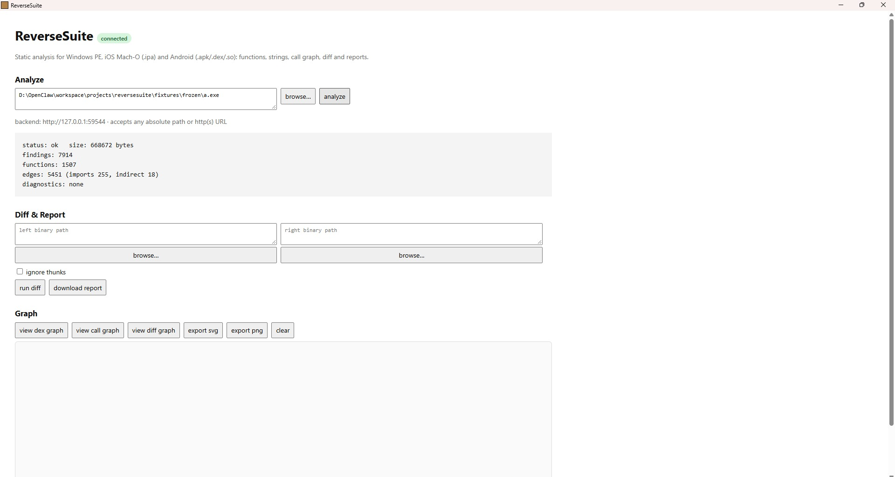
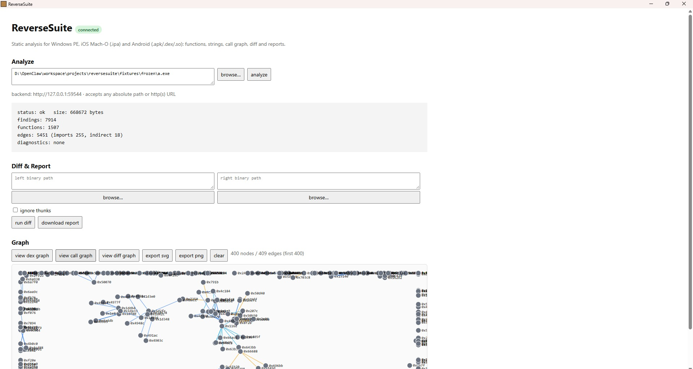
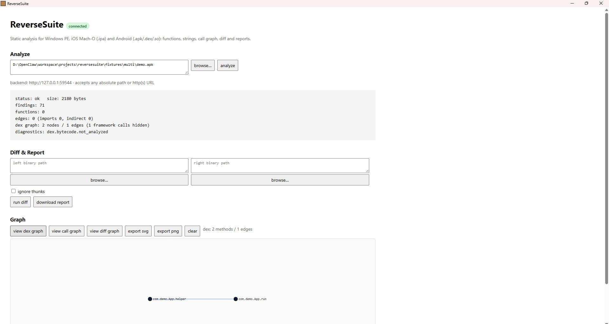
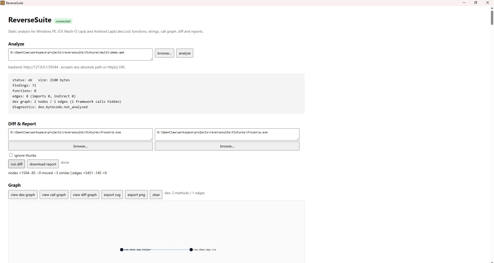

<div align="center">

# ⚙️ ReverseSuite

**Universal static binary analysis — Windows PE · iOS · Android · Linux ELF**

_See inside a binary without running it: disassembly, functions, strings, call graphs,_
_DEX method graphs, diffs and reports — from a CLI, a local API, or a desktop app._

<sub>Built by **riki-go** — <!-- replace with your real name / portfolio link if you want --></sub>

</div>

## AI skill (optional)

`skills/reversesuite/SKILL.md` documents the toolkit for an AI agent - exact commands,
JSON shapes (`dex_graph`), API parameters and the honest limits.

Agents only load a skill that sits in a directory they scan (`<workspace>/.agents/skills`,
`~/.agents/skills`). OpenClaw does **not** follow Windows junctions, so each skill has to be
a real directory - keep the copies in sync with the bundled script:

```powershell
powershell -ExecutionPolicy Bypass -File build/sync-skills.ps1          # mirror + verify
powershell -ExecutionPolicy Bypass -File build/sync-skills.ps1 -Check   # report drift only
```

The script copies every `skills/<name>/` into both agent directories, removes stale files
and fails when a `SKILL.md` hash differs. Restart the agent afterwards so its index is
rebuilt.

---

## What it is

ReverseSuite is a static analysis toolkit for reverse engineers, malware analysts and
security students. It never executes the target: every answer comes from parsing the
file format and reading bytes.

- **One analyzer, four ecosystems** — PE (`.exe`/`.dll`), Mach-O (`.ipa`), Android (`.apk`/`.dex`/`.so`) and ELF
- **Deterministic output** — same input, same JSON, sorted and hashed
- **No cloud, no telemetry** — local API bound to `127.0.0.1` with a per-session token

> Status: `v0.5.0` — feature set frozen for user testing. 192 unit tests, 0 network calls.

---

## Highlights

| | Capability | What you get |
| --- | --- | --- |
| 🪟 | **Windows PE analysis** | x86/x64 disassembly (Capstone), function discovery, imports/exports, 1,500+ functions per binary, string extraction with xrefs |
| 🍎 | **iOS Mach-O / `.ipa`** | Fat/thin slices, ARM64 function discovery, `__cstring`, symbols, **FairPlay encryption detection** (`cryptid`) |
| 🤖 | **Android `.apk` / `.dex`** | Decoded binary `AndroidManifest.xml` (package, SDK, permissions, exported components) **plus a method-level DEX call graph** from Dalvik `invoke` bytecode |
| 🐧 | **Linux ELF / `.so`** | Sections, symbols, entry point, function discovery for ARM64/x86-64 |
| 🔍 | **Call graphs** | Direct / tail / thunk edges, inter-procedural register/stack value sets, and a vtable inventory with RTTI class names |
| 🧮 | **Diff engine** | Compare two builds: added/removed functions and edges, "similar" matching, ignore-thunks mode |
| 📊 | **Interactive graphs** | Force-directed SVG in the desktop app, export to SVG/PNG, diff graph mode |
| 📄 | **Reports** | Self-contained HTML/JSON diff reports |
| 🖥️ | **Desktop app** | Tauri wrapper (4.5 MB) with bundled Python backend, MSI installer, Works offline |
| 🧠 | **AI Skills** | Documented, validated skill registry so an agent can drive ReverseSuite correctly |

---

## Screenshots

<sub>Drop your own images into `docs/screenshots/` using these file names — the layout is ready.</sub>

| Analyze | Call graph |
| --- | --- |
|  |  |

| DEX method graph | Diff report |
| --- | --- |
|  |  |

---

## Quick start

```bash
# from source
python -m venv .venv && .venv\Scripts\activate
pip install -r requirements.txt
python -m reversesuite analyze samples\demo.apk --json

# desktop app
msiexec /i ReverseSuite_0.5.1_x64_en-US.msi

# uninstall (keeps user data, like the MSI) or remove everything
powershell -ExecutionPolicy Bypass -File uninstall-clean.ps1 -KeepUserData
powershell -ExecutionPolicy Bypass -File uninstall-clean.ps1
```

Typical CLI output:

```text
kit     apk   format=apk
status  ok
findings 70  diagnostics 1
dexgraph 2 nodes / 1 edges (methods scanned 2, framework hidden 1)
```

### Clean uninstall

The MSI uninstall removes program files, registry keys and shortcuts, but keeps
`%LOCALAPPDATA%\ReverseSuite` (logs, session token) and
`%LOCALAPPDATA%\com.reversesuite.desktop` (WebView2 cache, ~75 MB) on purpose.
The packaged `uninstall-clean.ps1` runs the MSI uninstall and then deletes those
folders; pass `-KeepUserData` to keep the default behaviour.

### End-to-end UI test

`tests/e2e_ui.py` drives the real page in headless Chromium: it starts the backend, sets a
token, analyses a PE, opens the call graph, diffs two builds, checks the empty-input guard
and renders the DEX graph from an APK. It is opt-in because it needs a browser:

```powershell
.venv\Scripts\python.exe -m pip install playwright
.venv\Scripts\python.exe -m playwright install chromium
.venv\Scripts\python.exe tests\e2e_ui.py
```

Expected: seven `PASS` lines and `all ui checks passed`.

---

## Under the hood

```
src/reversesuite/
  formats/      pe.py  macho.py  elf.py  dex.py  dexgraph.py  axml.py  container.py
  loader.py     format detection + section/segment model
  disasm.py     Capstone wrapper (x86 / x86-64 / ARM64)
  functions.py  prologue heuristics + symbol/export seeding
  strings.py    ASCII/UTF-16 extraction with xrefs
  callgraph.py  direct / tail / thunk edges, optional value-flow
  diff.py       A/B comparison with similarity matching
  api.py        local HTTP API + graph UI
src-tauri/      desktop wrapper (Rust) + MSI packaging
skills/         validated skill registry (reversesuite, winremote)
```

| Layer | Technology |
| --- | --- |
| Parsing | Python 3.12, stdlib only for formats |
| Disassembly | Capstone |
| API | `http.server` on `127.0.0.1`, bearer token per session |
| Desktop | Tauri v2 (Rust) + PyInstaller sidecar |
| Tests | `unittest`, 196 cases, byte-exact fixture generators; plus `tests/e2e_ui.py` (Playwright) for the UI |

---

## Design notes

- **Nothing is executed.** The analyzer only reads bytes; no emulation, no sandboxes.
- **Evidence-first findings.** Every finding carries an offset and a rule id, so a claim can be checked.
- **Honest limits.** Encrypted iOS binaries are reported as encrypted, not guessed. Dalvik opcodes are not disassembled — the graph comes from the `invoke` stream.
- **Offline by default.** The API refuses foreign origins and only accepts paths inside an allow-listed root.

---

---

## ⚖️ Copyright and terms

```
Copyright (c) 2026 riki-go. All rights reserved.

Source code is provided for viewing only.
No copying, redistribution, modification, or commercial use is permitted
without prior written permission from the author.
```

**Source code is for viewing only. No copying or redistribution.**

This repository is published as a portfolio piece: you are welcome to read the code
and evaluate the design, but it is not open source and it is not licensed for reuse.
See [LICENSE](LICENSE) for the full terms.

<div align="center"><sub>Built with a lot of bytes, a little patience, and zero execution.</sub></div>
